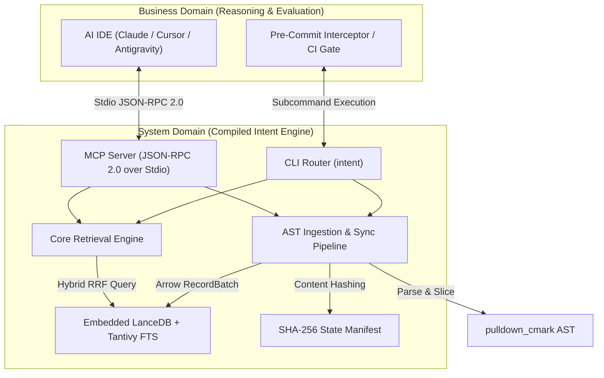

# Compiled Intent: System Architecture

## 1. System Overview

**Compiled Intent** is an episodic memory coprocessor and architectural enforcement engine written in Rust. It solves the problems of **Contextual Amnesia** and **Context Poisoning** in AI coding workflows by replacing volatile prompt stuffing with deterministic, compiler-grade retrieval.

### The Two Domains

- **System Domain (Compiled Intent)**: A deterministic, headless Rust engine (`intent`) that maintains a synchronized Apache Arrow / LanceDB vector database of local project intent (ADRs, Specs, Architecture Guides). It is completely domain-agnostic.
- **Business Domain (AI Agents & Merge Gates)**: Outer layers (Claude Desktop, Cursor, Antigravity, CI/CD pre-commit hooks) that query the engine via the **Model Context Protocol (MCP)** or CLI, evaluating code diffs against retrieved architectural constraints.



---

## 2. Core Architectural Pillars

### 2.1 Intra-Document Attention Firewall (AST Heading Chunking)

- Technical documents have strict semantic hierarchies.
- The engine parses Markdown using `pulldown_cmark`, using headings (`#`, `##`) as authoritative **Parent Block** boundaries.
- Slices dense child chunks ($\le 300$ characters) strictly *within* heading boundaries.
- Matches resolve back to full parent sections (`context_payload`), completely eliminating pronoun ambiguity while preventing intra-document attention bleed.

### 2.2 Inter-Document Attention Firewall (Directory Namespaces)

- Configured in `.intent/config.toml` (e.g. `adrs = "docs/adrs"`, `specs = "docs/specs"`).
- Slices from each directory inherit an exact `namespace` column in the unified LanceDB Arrow table.
- Pre-commit audit gates restrict queries to `namespace = "adrs"` to mathematically prevent descriptive specs from polluting normative architectural audits.

### 2.3 Tri-Modal Hybrid Search & Reciprocal Rank Fusion (RRF)

- Dense vector search fails on exact code symbols (`SessionLedger`, `CompitentError`); lexical search fails on abstract conceptual rules.
- LanceDB executes concurrent vector cosine search and Tantivy BM25 scalar search, fusing rank positions using scale-invariant Reciprocal Rank Fusion ($k=60$).

### 2.4 Differential State Synchronization

- Content-addressed SHA-256 manifest (`.intent/manifest.json`) detects modified, added, and deleted files.
- Exits in <10ms when the cache is warm.
- Scoped orphan purging ensures deleted files are evicted from LanceDB storage without cross-directory data loss.

### 2.5 Stdio Wire Isolation

- When running as an MCP server daemon, `stdout` is reserved 100% for valid JSON-RPC 2.0 frames.
- All telemetry, logging, and diagnostics are strictly emitted to `stderr`.

---

## 3. Workspace Hierarchy & Separation of Concerns

Per [ADR-012](./adrs/012-engine-tooling-workspace-separation.md), the codebase is organized as a two-crate Cargo workspace partitioned into library (`compitent-engine`) and tooling CLI (`intent`):

```
crates/
├── engine/             <-- Library crate: compitent-engine (storage, chunking, retrieval)
│   ├── Cargo.toml
│   └── src/
│       ├── lib.rs      <-- Public library API & re-exports (retrieval re-exported as engine)
│       ├── config/     <-- EngineConfig (deterministic embedding & storage parameters)
│       ├── error.rs    <-- CompitentError enum
│       ├── indexer/    <-- Markdown AST chunking, Arrow RecordBatch building, and storage
│       │   ├── arrow_builder.rs
│       │   ├── manifest.rs
│       │   ├── markdown_chunker.rs
│       │   └── storage.rs
│       ├── retrieval/  <-- Core storage orchestration, LanceDB schema, Tantivy FTS, Hybrid Search
│       └── telemetry.rs<-- Stderr-isolated tracing subscriber initialization
└── cli/                <-- Binary crate: intent (canonical unified CLI & MCP daemon per ADR-006)
    ├── Cargo.toml
    └── src/
        ├── main.rs     <-- Entrypoint, CLI parsing, dispatch
        ├── config.rs   <-- CliConfig and LlmConfig loading
        ├── audit/      <-- Native architectural guardian pre-commit / CI gate (ADR-011)
        │   ├── git.rs
        │   ├── reporter.rs
        │   └── mod.rs
        ├── llm/        <-- Decoupled HTTP LLM inference client and prompt formatting (ADR-008/010)
        │   ├── client.rs
        │   ├── prompt.rs
        │   └── mod.rs
        └── mcp/        <-- Headless JSON-RPC 2.0 protocol handling and tool dispatch (ADR-005)
            ├── mod.rs
            └── tools.rs
```

### Separation Invariants

1. **Strict Dependency Directionality**: `crates/cli` depends on `crates/engine`. `crates/engine` has zero knowledge of Git, terminal formatting, or generative LLMs.
2. **Determinism vs. Stochasticity**: `crates/engine` is strictly deterministic (embeddings and greedy search). Stochastic sampling (`temperature`), LLM prompts, and chat completion logic belong exclusively to `crates/cli`.
3. **The Indexer MUST NOT know about MCP or CLI**: Storage and chunking operate independently of transport protocols.
4. **The MCP layer MUST NOT directly access LanceDB or filesystem tables**: It must route all operations through `compitent-engine`.
5. **The Core Engine exposes pure Rust data structures** independent of JSON-RPC or CLI representations.

---

## 4. Documentation Architecture

The `docs/` directory follows the industry standard separating **Contracts (WHAT)** from **Decisions (WHY)**:

- [docs/specs/](./specs): Living functional specifications defining schemas, CLI flags, protocols, and invariants.
- [docs/adrs/](./adrs): Immutable chronological decision records evaluating competing options, trade-offs, and consequences.
