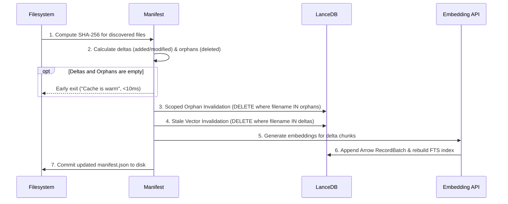

# 04-REQ-SYNC-LIFECYCLE: Differential Sync and Cache Invalidation

> [!NOTE] **Architectural Rationale**
> For the design decision to use a content-addressed SHA-256 state manifest over Git-diff tracking, see [ADR-004: Differential State Manifest and Scoped Orphan Purging](file:///Users/vj/workspace/blogging-assistant/compiled-intent/docs/adrs/004-differential-manifest-sync.md).

## 1. State Manifest Specification

The engine MUST maintain a local JSON state manifest file (`.intent/manifest.json`) tracking the exact content hash of all indexed documents:

```json
{
  "files": {
    "docs/adrs/001-storage.md": "a8f5c3...",
    "docs/specs/01-mcp.md": "4b2e19..."
  }
}
```

### 1.1 Hash Algorithm

- Content hashes MUST be computed using **SHA-256** encoded as 64-character lowercase hexadecimal strings.
- **Line Ending Normalization**: Frontmatter and content slicing MUST handle Windows CRLF (`\r\n`) and Unix LF (`\n`) identically.

### 1.2 Corruption Recovery

- If the manifest file is missing, empty, or unparseable, the engine MUST log a warning and fall back to an empty manifest without panicking.

## 2. The 5-Stage Synchronization Lifecycle



### 2.1 Scoped Orphan Purging Invariant

- Orphan detection MUST be strictly scoped to the directories currently being scanned.
- If directory `docs/adrs/` is being indexed, deleted files in `docs/adrs/` MUST be detected and purged.
- Files recorded in the manifest belonging to *unscanned directories* (e.g. `ops/runbooks/`) MUST NOT be purged as orphans.

### 2.2 SQL Injection Sanitization

- Invalidation queries executed against LanceDB MUST sanitize single-quote characters by escaping them as double single-quotes (`' -> ''`):

  ```rust
  let escaped = path.replace('\'', "''");
  format!("filename = '{}'", escaped)
  ```
